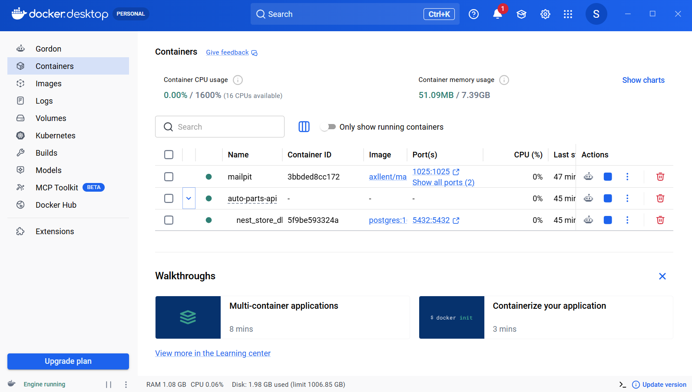
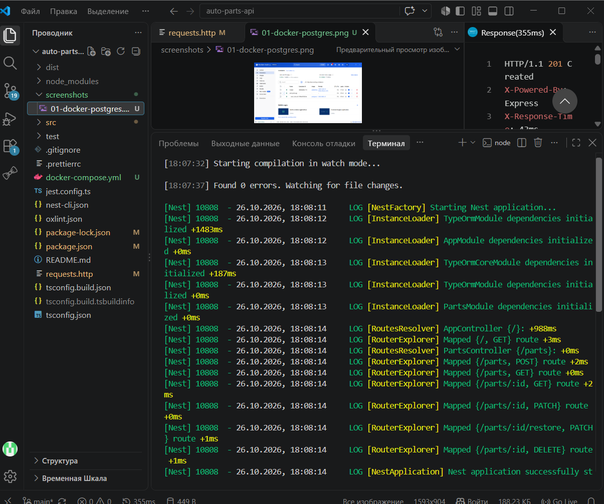
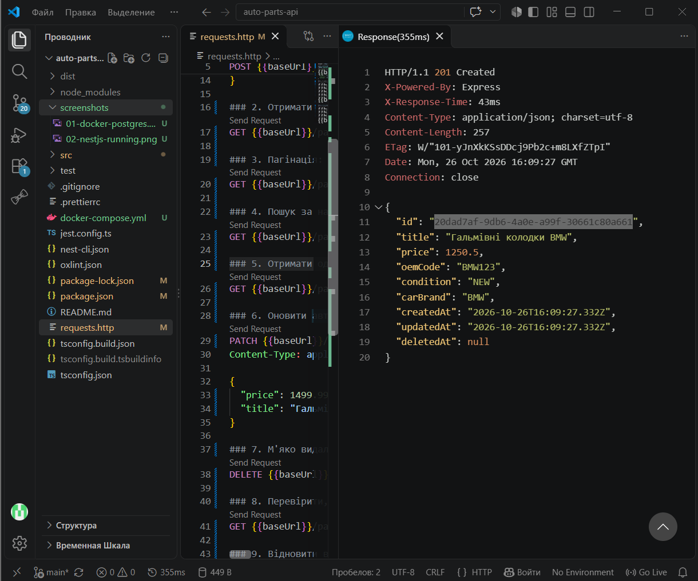
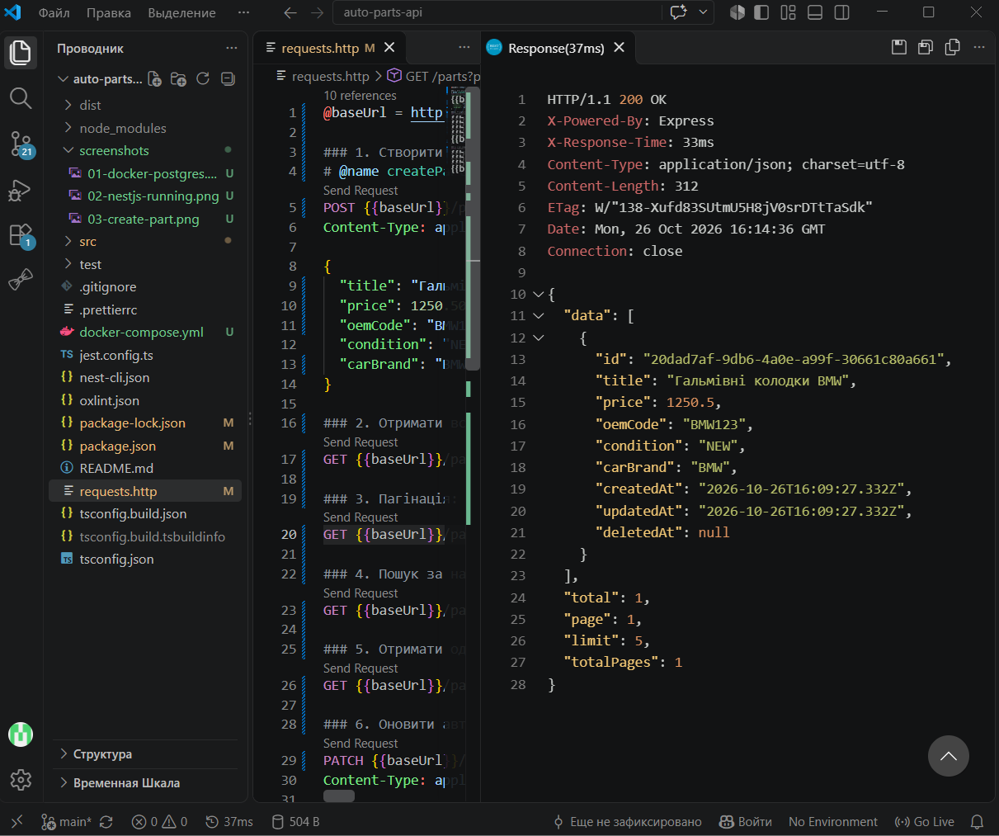
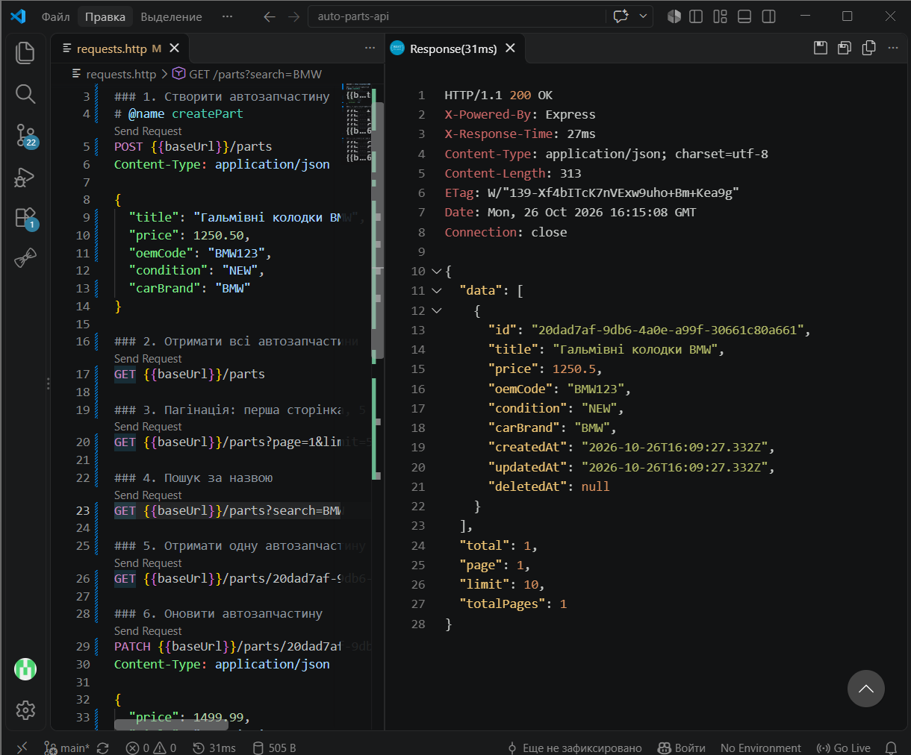
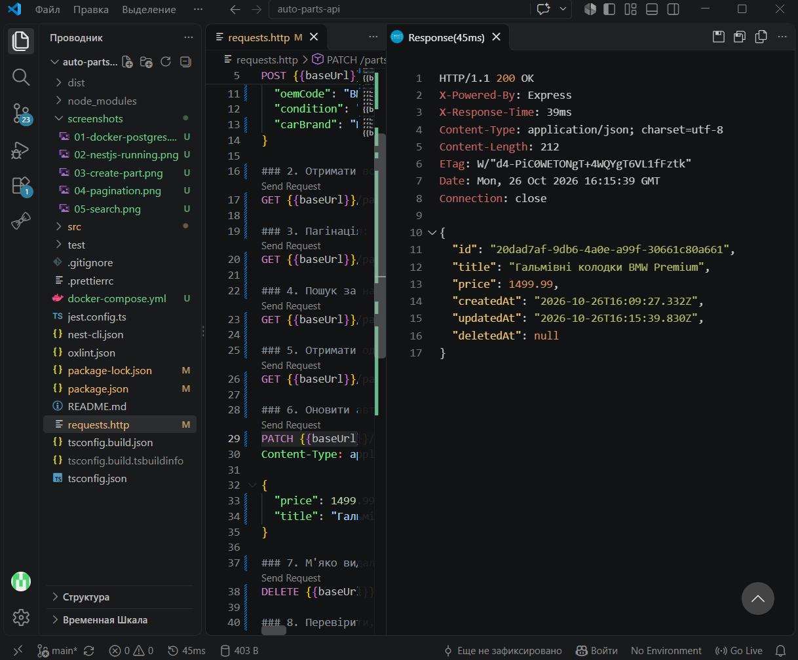
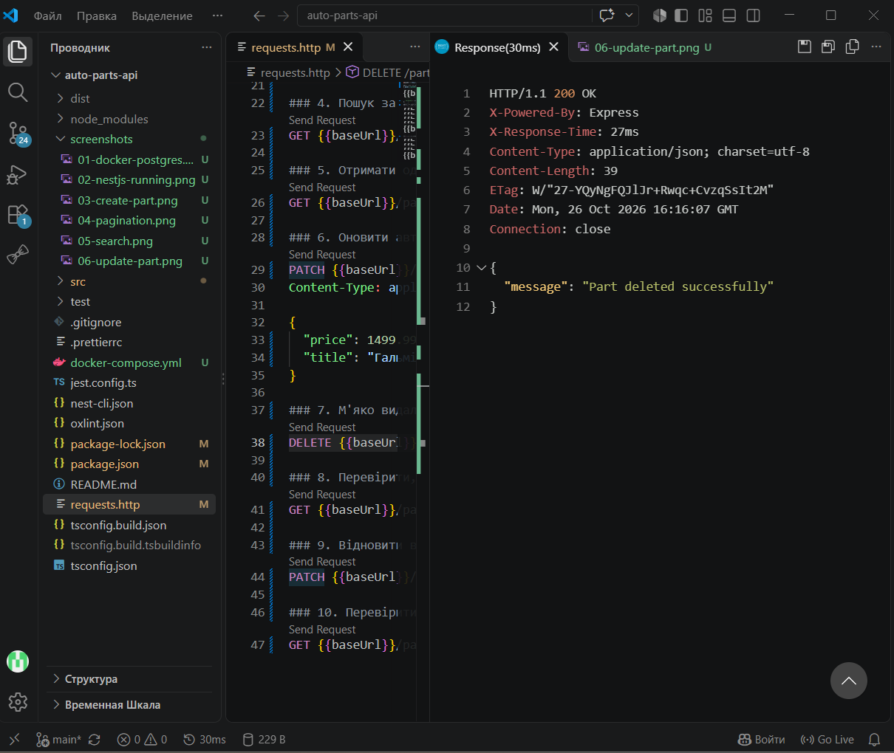
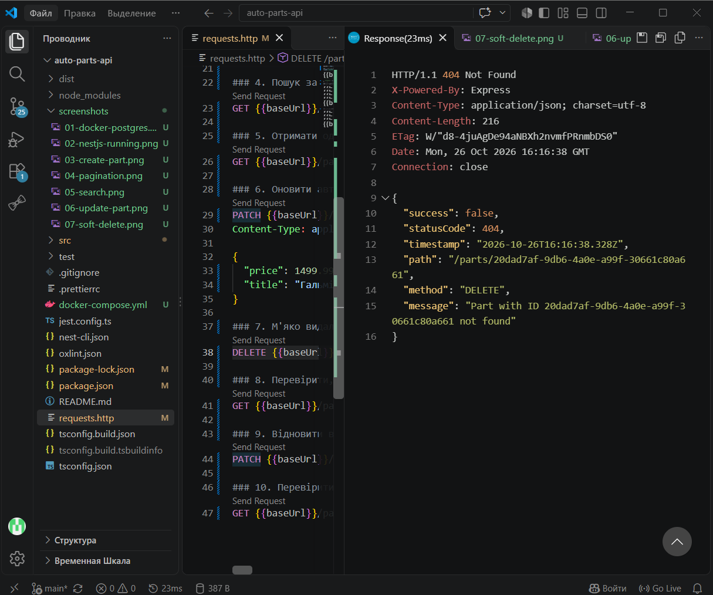
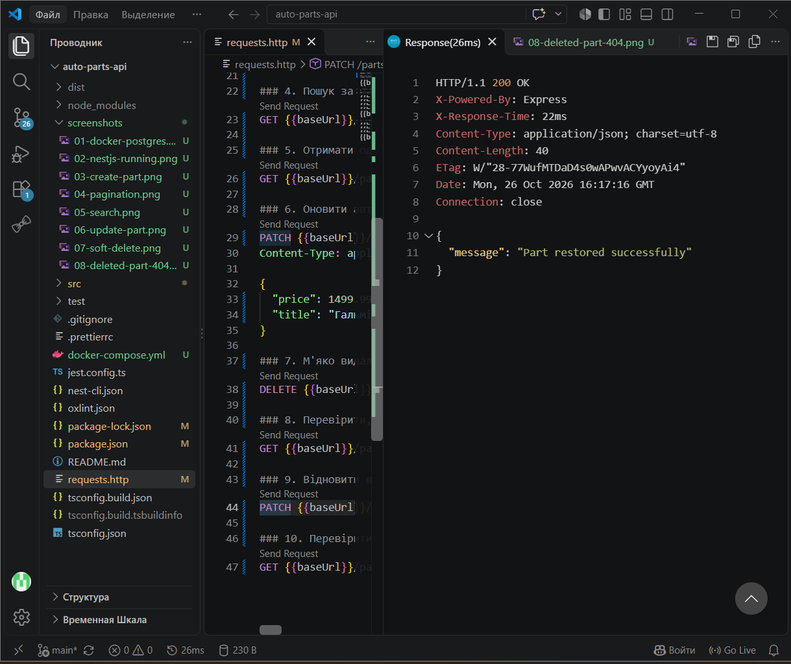
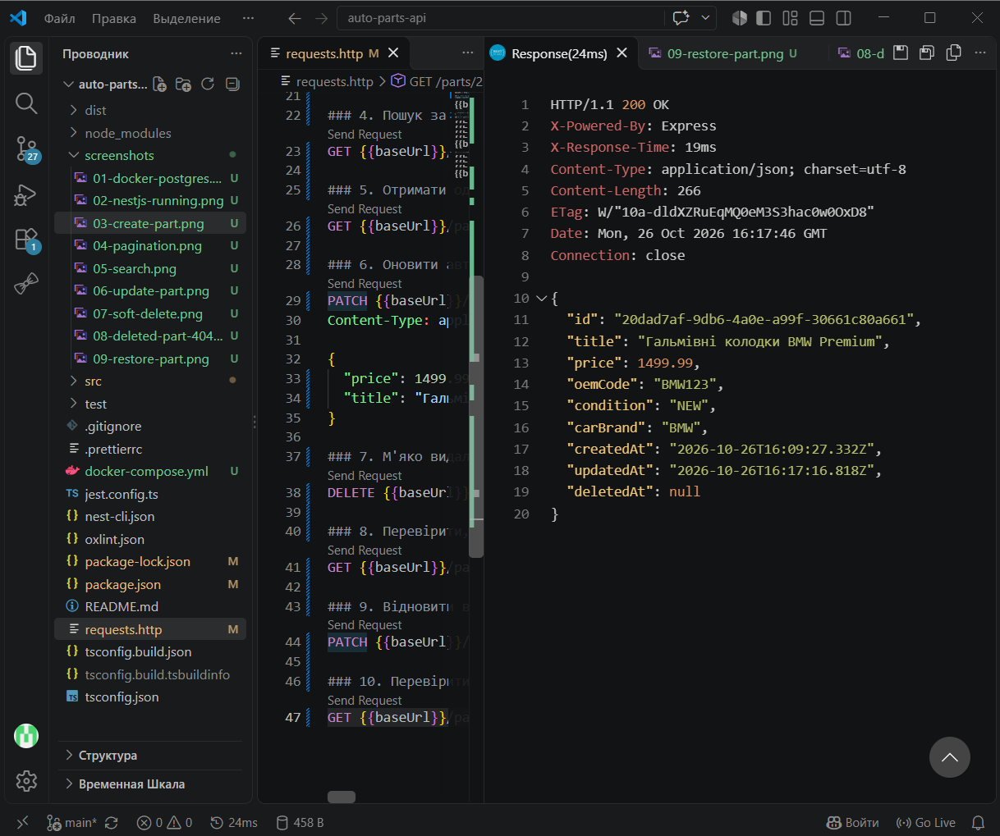

# Практична робота № 7

## Підключення PostgreSQL і TypeORM у NestJS. API автозапчастин

### Тема роботи

Робота з реляційною базою даних PostgreSQL у застосунку NestJS за допомогою TypeORM.

### Мета роботи

Навчитися підключати PostgreSQL до NestJS, описувати сутності через Entity, виконувати CRUD-операції через Repository, реалізовувати пагінацію, пошук, м’яке видалення та відновлення записів.

### Варіант

**№ 7 — API для автозапчастин.**

## 1. Використані технології

- Node.js
- TypeScript
- NestJS
- PostgreSQL 16
- Docker Compose
- TypeORM
- `class-validator`
- `class-transformer`
- REST Client для Visual Studio Code

## 2. Запуск проєкту

Для запуску застосунку необхідно виконати такі дії.

1. Запустити Docker Desktop.
2. У корені проєкту запустити контейнер PostgreSQL:

   ```bash
   docker compose up -d
   ```

3. Перевірити стан контейнера:

   ```bash
   docker compose ps
   ```

4. Встановити залежності:

   ```bash
   npm install
   ```

5. Запустити NestJS:

   ```bash
   npm run start:dev
   ```

Застосунок використовує PostgreSQL на порту `5432` і запускає HTTP API на порту `3000`.

> **Примітка:** параметр `synchronize: true` у TypeORM використовується для навчальної розробки. У production-середовищі рекомендується використовувати міграції.

## 3. Структура бази даних

Для представлення автозапчастин створено сутність `AutoPartEntity`, яка відповідає таблиці `parts` у PostgreSQL.

| Поле | Тип / призначення |
|---|---|
| `id` | UUID, первинний ключ |
| `title` | Назва автозапчастини, до 150 символів |
| `price` | Ціна типу `decimal(10,2)` |
| `oemCode` | OEM-код, до 50 символів |
| `condition` | Стан: `NEW` або `REFURBISHED` |
| `carBrand` | Марка автомобіля, до 80 символів |
| `createdAt` | Дата й час створення |
| `updatedAt` | Дата й час останнього оновлення |
| `deletedAt` | Дата м’якого видалення або `NULL` |

Для генерації UUID використовується `@PrimaryGeneratedColumn('uuid')`.

Для автоматичного керування датами застосовуються декоратори `@CreateDateColumn`, `@UpdateDateColumn` і `@DeleteDateColumn`.

## 4. Реалізовані API-маршрути

| HTTP-метод | Маршрут | Призначення |
|---|---|---|
| `POST` | `/parts` | Створення автозапчастини |
| `GET` | `/parts` | Отримання списку автозапчастин |
| `GET` | `/parts/:id` | Отримання автозапчастини за UUID |
| `PATCH` | `/parts/:id` | Оновлення автозапчастини |
| `DELETE` | `/parts/:id` | М’яке видалення автозапчастини |
| `PATCH` | `/parts/:id/restore` | Відновлення видаленої автозапчастини |

## 5. Пагінація та пошук

Для отримання списку реалізовано такі query-параметри:

- `page` — номер сторінки, починаючи з `1`;
- `limit` — максимальна кількість записів на сторінці;
- `search` — пошук автозапчастин за назвою.

Приклад запиту:

```http
GET /parts?page=1&limit=5&search=BMW
```

Для реалізації пагінації використовується метод TypeORM `findAndCount()` із параметрами `skip` і `take`.

Відповідь містить такі поля:

- `data` — записи поточної сторінки;
- `total` — загальна кількість знайдених записів;
- `page` — поточна сторінка;
- `limit` — кількість записів на сторінці;
- `totalPages` — загальна кількість сторінок.

## 6. М’яке видалення та відновлення

Для видалення автозапчастин використовується метод TypeORM `softDelete()`. Він встановлює дату в полі `deletedAt`, не видаляючи запис фізично з бази даних.

Звичайний запит отримання запису за UUID не повертає м’яко видалені записи.

Для відновлення використовується метод `restore()`, який прибирає позначку видалення. Після відновлення автозапчастина знову доступна через звичайні GET-запити.

## 7. Результати тестування

### 7.1. Запуск PostgreSQL у Docker

Перевірено, що контейнер PostgreSQL запущений.



### 7.2. Запуск NestJS

Перевірено успішний запуск застосунку NestJS.



### 7.3. Створення автозапчастини

Виконано запит `POST /parts` для створення нового запису. У відповіді повертаються дані автозапчастини та її UUID.



### 7.4. Пагінація списку

Перевірено отримання списку автозапчастин із використанням параметрів `page` і `limit`.



### 7.5. Пошук за назвою

Перевірено пошук автозапчастин за допомогою параметра `search`.



### 7.6. Оновлення автозапчастини

Виконано запит `PATCH /parts/:id` для зміни назви та ціни автозапчастини.



### 7.7. М’яке видалення

Виконано запит `DELETE /parts/:id`. Запис позначається видаленим, але залишається в базі даних.



### 7.8. Перевірка видаленого запису

Після м’якого видалення запит `GET /parts/:id` повертає помилку `404 Not Found`.



### 7.9. Відновлення автозапчастини

Виконано запит `PATCH /parts/:id/restore` для відновлення видаленого запису.



### 7.10. Перевірка відновленого запису

Після відновлення автозапчастина знову доступна через запит `GET /parts/:id`.



## 8. Висновок

Під час виконання практичної роботи було налаштовано підключення NestJS до PostgreSQL за допомогою TypeORM. Створено сутність автозапчастини та реалізовано CRUD-операції через Repository. Додано пагінацію, пошук за назвою, м’яке видалення та відновлення записів.

Роботу API перевірено за допомогою HTTP-запитів у REST Client. У результаті реалізовано API автозапчастин із постійним зберіганням даних у PostgreSQL.