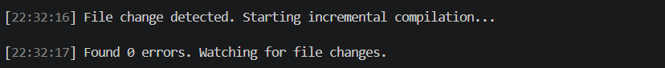
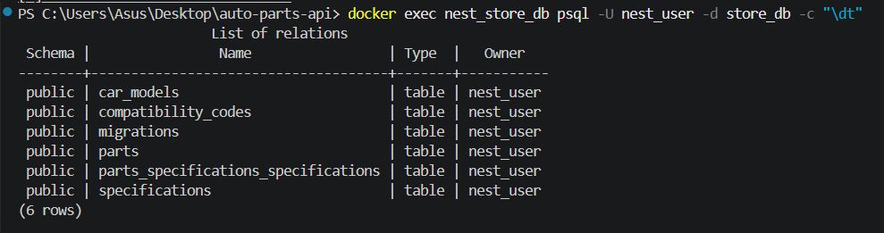
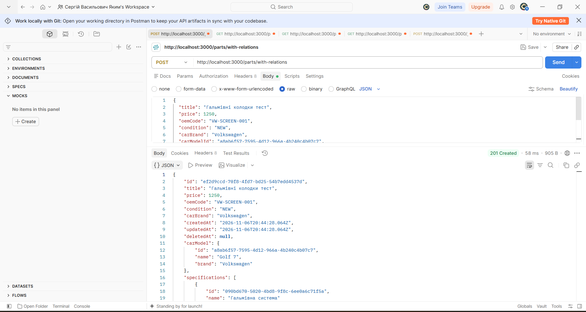
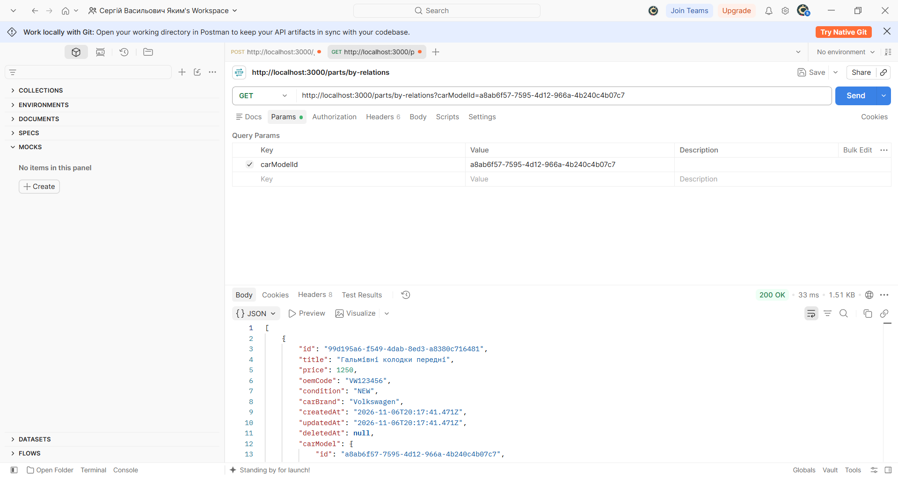
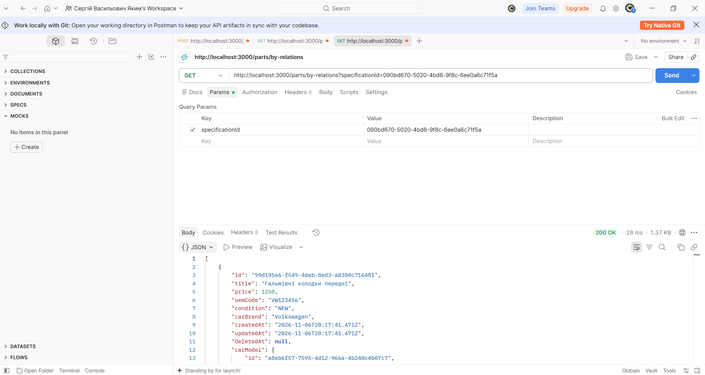
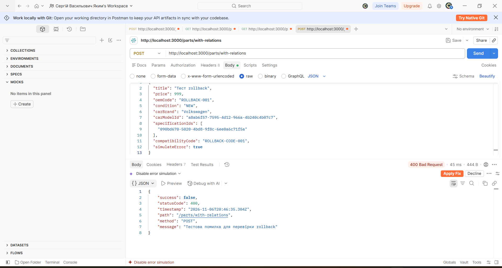
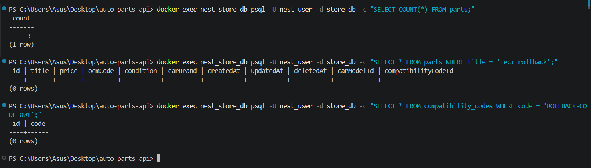

# Практична робота №8
## Моделювання зв’язків між сутностями та керування міграціями

**Варіант:** 7 — Автозапчастини

### 1. Мета роботи

Ознайомитися з моделюванням зв’язків між сутностями за допомогою TypeORM, навчитися керувати міграціями бази даних, використовувати QueryBuilder для отримання пов’язаних даних та транзакції для забезпечення цілісності даних.

### 2. Реалізація зв’язків між сутностями

У проєкті реалізовано такі сутності:

- `AutoPartEntity` — автозапчастини;
- `CarModelEntity` — моделі автомобілів;
- `SpecificationEntity` — характеристики запчастин;
- `CompatibilityCodeEntity` — коди сумісності.

Між сутностями реалізовано три типи зв’язків:

- **OneToMany / ManyToOne** — одна модель автомобіля може мати багато запчастин.
- **ManyToMany** — одна запчастина може мати декілька характеристик, а одна характеристика може належати декільком запчастинам.
- **OneToOne** — кожна запчастина може мати один унікальний код сумісності.

Також налаштовано параметри `cascade` та `onDelete: 'CASCADE'` для автоматичного керування пов’язаними записами.

### 3. Міграції бази даних

Для керування структурою бази даних використовується TypeORM CLI. Було створено та застосовано міграцію, яка додає нові таблиці, зовнішні ключі та таблицю для зв’язку ManyToMany.

Основні команди:

```powershell
npx ts-node .\node_modules\typeorm\cli.js -d src/database/data-source.ts migration:generate src/database/migrations/InitialCreate

npx ts-node .\node_modules\typeorm\cli.js -d src/database/data-source.ts migration:run

npx ts-node .\node_modules\typeorm\cli.js -d src/database/data-source.ts migration:revert
```

Остання команда призначена для скасування останньої застосованої міграції.





### 4. Створення запчастин із пов’язаними даними

Реалізовано endpoint `POST /parts/with-relations`, який дозволяє створювати запчастину разом із моделлю автомобіля, характеристиками та кодом сумісності.

Для цього використовується транзакція TypeORM.



### 5. Отримання даних через QueryBuilder

Для отримання запчастин із пов’язаними сутностями використовується QueryBuilder та `leftJoinAndSelect`.

Реалізовано фільтрацію за моделлю автомобіля та характеристикою:

- `GET /parts/by-relations?carModelId=...`
- `GET /parts/by-relations?specificationId=...`

Також реалізовано отримання однієї запчастини разом із її зв’язками.





### 6. Перевірка транзакцій та rollback

Для перевірки транзакцій реалізовано можливість штучно викликати помилку під час створення запчастини через параметр `simulateError`.

У разі виникнення помилки транзакція скасовується, тому запчастина та пов’язаний код сумісності не зберігаються в базі даних.



Після виконання запиту було перевірено базу даних. Тестові записи з кодом `ROLLBACK-CODE-001` та назвою `Тест rollback` відсутні.



### 7. Висновок

Під час виконання практичної роботи було реалізовано зв’язки OneToMany, ManyToOne, ManyToMany та OneToOne між сутностями автозапчастин. Налаштовано каскадні операції, створено та застосовано міграцію бази даних. За допомогою QueryBuilder реалізовано отримання та фільтрацію пов’язаних даних. Також перевірено роботу транзакцій і механізму rollback, який забезпечує цілісність даних у разі виникнення помилок.