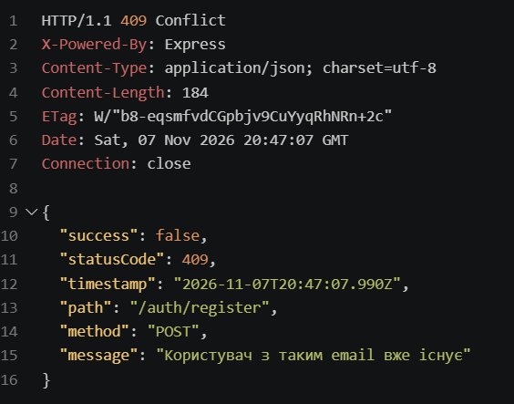
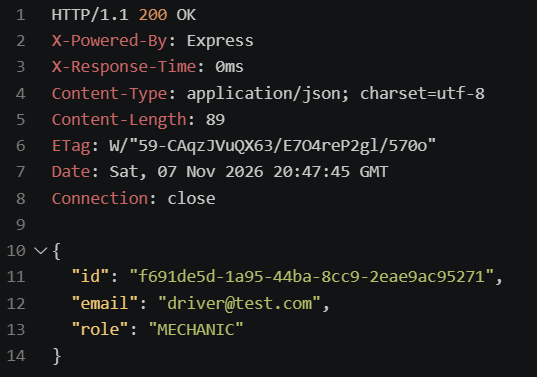
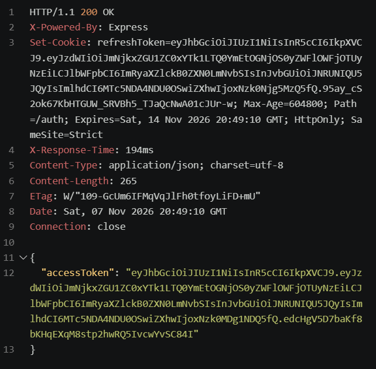
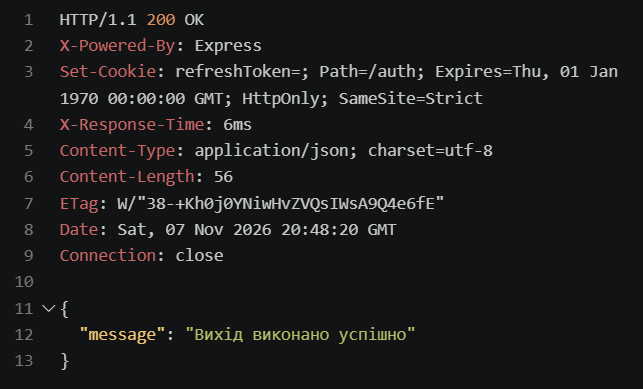
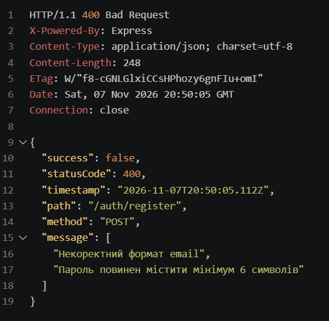
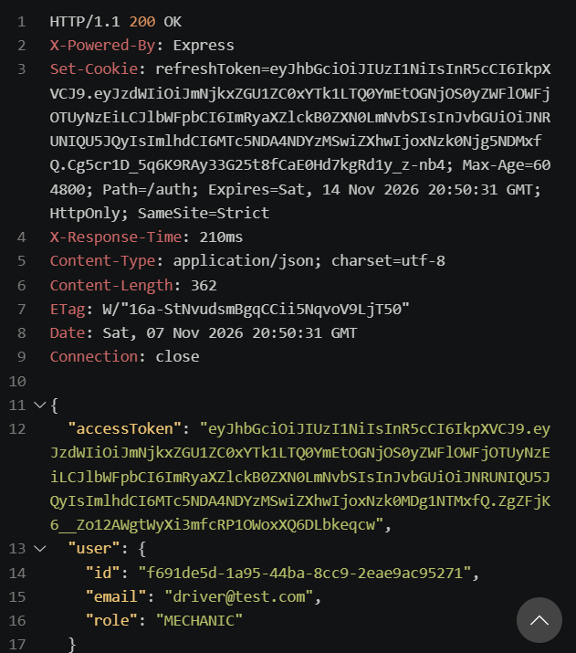

# Практична робота №9
## Реалізація автентифікації та рольової авторизації

**Мета роботи:** реалізувати механізм автентифікації користувачів, захист API за допомогою JWT та розмежування доступу відповідно до ролей.

### Використані технології
- NestJS
- TypeORM
- PostgreSQL
- JWT (Access Token та Refresh Token)
- Passport
- bcrypt
- class-validator

### Реалізований функціонал

1. Реєстрація користувачів із хешуванням паролів.
2. Авторизація користувачів за email і паролем.
3. Генерація Access Token та Refresh Token.
4. Зберігання Refresh Token у захищеній HttpOnly cookie та його ротація.
5. Отримання профілю авторизованого користувача.
6. Вихід із системи з інвалідацією Refresh Token.
7. Перевірка вхідних даних за допомогою DTO та ValidationPipe.
8. Рольова авторизація з ролями ADMIN, MECHANIC та DRIVER.
9. Обмеження доступу до операцій із запчастинами відповідно до ролей.

### Результати тестування

- Реєстрація користувача — успішно.
- Авторизація та отримання JWT — успішно.
- Отримання профілю користувача — успішно.
- Оновлення токенів — успішно.
- Вихід із системи — успішно.
- Перевірка неправильних реєстраційних даних — успішно, HTTP 400.
- Перевірка забороненого доступу до створення запчастини для MECHANIC — HTTP 403.
- Перевірка доступу MECHANIC до створення запчастини зі зв'язками — перевірка ролі пройдена, але створення потребує додаткової перевірки даних.

### Скріншоти

### Скріншоти

1. Реєстрація та авторизація

2. Отримання профілю

3. Оновлення токенів

4. Вихід із системи

5. Перевірка валідації

6. Перевірка рольової авторизації

### Висновок

У ході практичної роботи реалізовано автентифікацію користувачів за допомогою JWT, механізм оновлення та інвалідації токенів, перевірку вхідних даних і рольову авторизацію. Проведено тестування основних сценаріїв роботи системи та перевірено обмеження доступу до захищених ресурсів.
